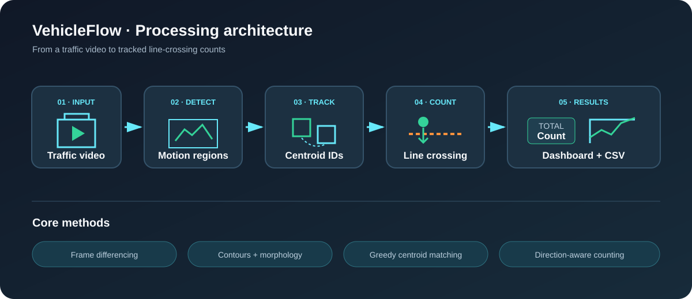

# VehicleFlow 🚦
### Vehicle Detection & Counting with OpenCV

[](https://github.com/sunny-shrivas/Vehicle-Detection-and-couting-/actions/workflows/tests.yml)


**VehicleFlow** is a Python-based traffic video analysis prototype. It detects moving regions in fixed-camera footage, associates detections across frames, and counts tracked objects when they cross a configurable virtual line.

The project modernizes the original vehicle-counting script into a modular OpenCV pipeline with a Streamlit interface, CSV reporting, and automated tests.

> [!NOTE]
> This implementation uses **classical motion detection**, not a trained vehicle detector such as YOLO. It detects moving regions rather than identifying vehicle classes. The width-based size grouping is only a rough heuristic and should not be treated as reliable vehicle classification.

---

## Visual pipeline



1. **Video input** — upload a traffic clip through the Streamlit interface.
2. **Motion detection** — grayscale conversion, Gaussian blur, frame differencing, thresholding, and morphology.
3. **Object proposals** — contours are filtered by area and converted to bounding boxes.
4. **Centroid tracking** — nearby detections are associated with existing track IDs.
5. **Line crossing** — each tracked object is counted once when it crosses the selected line in the configured direction.
6. **Results** — review live counts and download a frame-by-frame CSV report.

## Features

- Upload MP4, AVI, MOV, and MKV traffic videos.
- Configurable horizontal counting-line position.
- Count downward, upward, or both crossing directions.
- Frame-difference motion detection with morphological noise cleanup.
- Centroid-based tracking with predicted positions and missed-frame tolerance.
- Per-track duplicate prevention during a counting run.
- Live annotated frame preview and count metrics.
- Count timeline and downloadable CSV report.
- Unit tests and GitHub Actions workflow.

## Tech stack

| Area | Technology |
|---|---|
| Language | Python 3 |
| Computer vision | OpenCV |
| Numerical processing | NumPy |
| Dashboard | Streamlit |
| Tabular reports | Pandas |
| Testing | Pytest |
| CI | GitHub Actions |

## Run locally

### 1. Clone the repository

```bash
git clone https://github.com/sunny-shrivas/Vehicle-Detection-and-couting-.git
cd Vehicle-Detection-and-couting-
```

### 2. Create and activate a virtual environment

**macOS / Linux**
```bash
python3 -m venv .venv
source .venv/bin/activate
```

**Windows PowerShell**
```powershell
py -3.11 -m venv .venv
.\.venv\Scripts\Activate.ps1
```

### 3. Install dependencies

```bash
python -m pip install --upgrade pip
pip install -r requirements.txt
```

### 4. Launch VehicleFlow

```bash
streamlit run app.py
```

Open the local Streamlit URL shown in the terminal, upload a traffic video, adjust the settings in the sidebar, and select **Start analysis**.

## Configuration guide

| Setting | What it controls | Tuning guidance |
|---|---|---|
| Counting line position | Vertical position of the horizontal count line | Place it where objects are clearly separated |
| Count direction | Upward, downward, or either crossing | Match the traffic flow in the clip |
| Minimum moving-object area | Smallest contour area considered | Increase to reduce noise; decrease for distant objects |
| Tracker matching distance | Maximum centroid distance for association | Tune for frame rate, object speed, and video resolution |
| Large-vehicle width threshold | Splits detections into two width groups | Camera-specific heuristic; not a vehicle classifier |
| Frame stride | Number of frames skipped between processed frames | Use 1 for best tracking continuity |

## Project structure

```text
.
├── app.py                       # Streamlit application
├── vehicle_counter/
│   ├── detector.py               # Frame-difference motion detector
│   ├── tracker.py                # Centroid-based object tracker
│   ├── counting.py                # Direction-aware line counter
│   └── pipeline.py                # Connects detection, tracking, and counting
├── tests/
│   └── test_counting.py           # Tracker and counting tests
├── assets/
│   └── vehicleflow-architecture.svg
├── requirements.txt
├── pytest.ini
└── .github/workflows/tests.yml    # CI workflow
```

The original `Code` source file and `IJRAR_Certificate_IJRAR_288114.pdf` are retained in the repository for reference.

## Run tests

```bash
python -m pytest -q
```

The test suite covers:
- Track identity association for nearby detections.
- Creation of a new track for a distant detection.
- Direction-aware virtual-line crossing.
- Counting a track only once.
- Width-grouping threshold behavior.

GitHub Actions runs the tests and Python compilation check on pushes to the main branch and the modernization branch.

## Known limitations

- Frame differencing detects **motion**, not vehicles. Pedestrians, shadows, rain, camera shake, and lighting changes may create false detections.
- Stationary vehicles may no longer be detected once their motion stops.
- Overlapping objects can merge into one contour or split into multiple detections.
- Greedy centroid matching can lose or swap identities in dense traffic.
- Width-based grouping depends on camera perspective, object distance, and resolution.
- Results depend on the camera angle and manually tuned thresholds.
- The project has not been benchmarked against a labelled dataset; **no accuracy percentage is claimed**.

This is an educational/research prototype, not a production traffic-monitoring, enforcement, or safety-critical system.

## Roadmap

- [ ] Add a real sample traffic clip and an authentic annotated output screenshot.
- [ ] Evaluate counting performance on labelled video with precision/recall and count error.
- [ ] Add a trained vehicle detector and class-aware tracking.
- [ ] Improve tracking for crowded scenes and temporary occlusions.
- [ ] Add perspective calibration and configurable regions of interest.

## Author

**Sunny Shrivas**

If you find the project useful, consider starring the repository.
